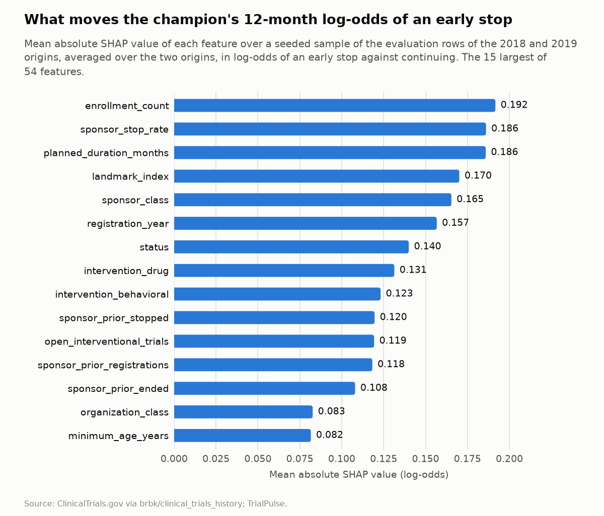
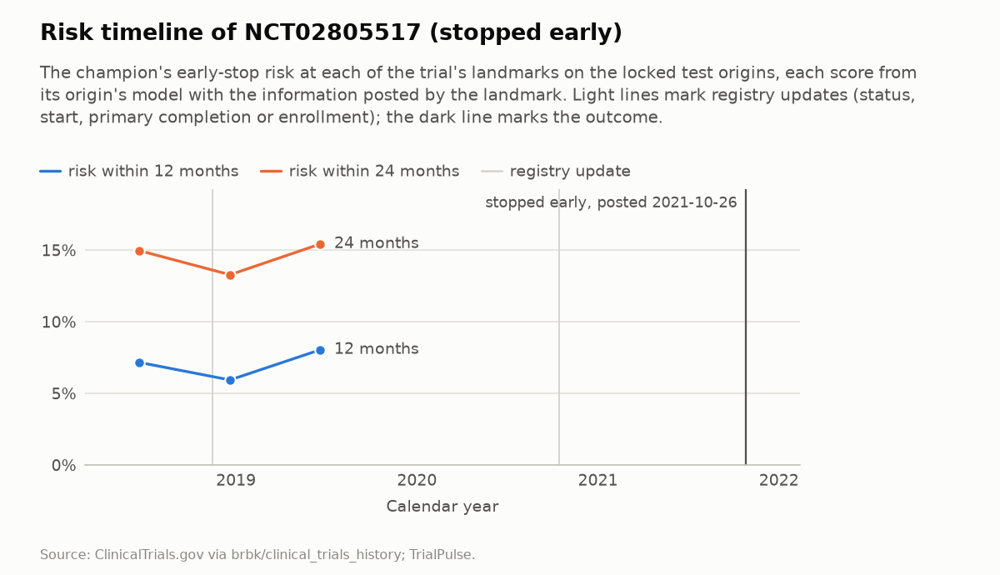
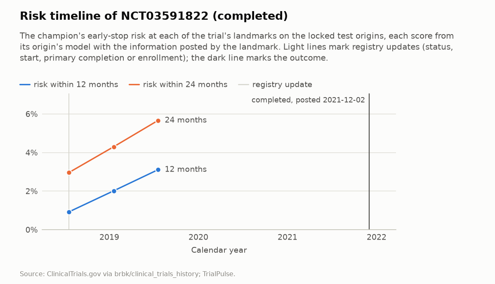
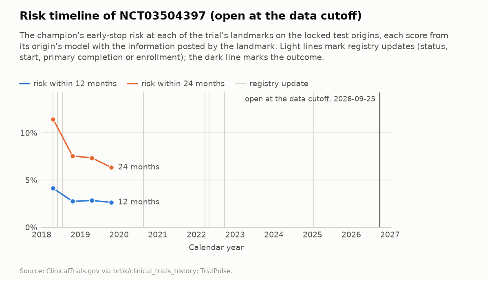

# Explanations of the champion

Research demo. Not medical advice. Not for patient decision-making.

This file is generated by `uv run python -m trialpulse.explain.report --unlock-test` (CLAUDE.md Step 12, ADR 0033). Do not edit it by hand. An elevated early-stop risk is an operational statement about a registry record; it says nothing about whether a treatment works. The registered results are in [results.md](results.md); nothing here changes them.

- **Source:** [ClinicalTrials.gov](https://clinicaltrials.gov) registry records, through the version-history dataset `brbk/clinical_trials_history` (license CC-BY-NC-4.0), revision v2026.09.26. Data as of 2026-09-25. TrialPulse normalizes the records and derives every score and driver here; these are not part of ClinicalTrials.gov (ADR 0008).
- **Model:** the champion, M4 (ADR 0026), of each locked test origin (2018 and 2019), fitted again as the locked run fitted it from commit `2ee8498a2fce`, and used because it reproduces every score that run saved.

## How the drivers are computed

M4 predicts, for each 6-month interval after a landmark, whether a trial continues, stops early or completes. Its trees give, for each interval, a raw score per outcome, and TreeSHAP (LightGBM's own `pred_contrib`) splits each raw score exactly into one SHAP value per feature. A driver's value is its SHAP value for the log-odds of an early stop against continuing, averaged over the intervals of the horizon (two for 12 months, four for 24). A positive value raises the model's odds of an early stop against continuing; a negative one lowers them. The interval number itself is set by the horizon and is never listed as a driver.

The explained log-odds is not the served risk, which also depends on the chance of completing first. The table below says how closely the two rank the same rows (Spearman's rank correlation), and that every model reproduces the scores the locked run saved.

| Origin | Evaluation rows | Rows explained | Model | Largest difference from the saved scores | Rank agreement, 12 months | Rank agreement, 24 months | Largest additivity gap |
| --- | --- | --- | --- | --- | --- | --- | --- |
| 2018-01-01 | 86,556 | 20,000 | 1,046 rounds (cache) | 0.0e+00 | 0.972 | 0.930 | 3.4e-14 |
| 2019-01-01 | 90,985 | 20,000 | 1,146 rounds (cache) | 0.0e+00 | 0.975 | 0.934 | 2.5e-14 |

## What moves the explained log-odds

The mean absolute SHAP value of each feature over a seeded sample of the evaluation rows of the 2018 and 2019 origins. The direction says, for a number feature, whether higher values go with higher SHAP values in the 12-month explanation of the 2018 sample (Spearman's correlation of at least 0.1 in size; otherwise mixed); a category or flag has none here. A feature can matter a lot and still go either way.

| Feature | Family | 12 months, 2018 | 12 months, 2019 | 12 months, mean | 24 months, mean | Direction |
| --- | --- | --- | --- | --- | --- | --- |
| enrollment_count | design | 0.198 | 0.185 | 0.192 | 0.191 | higher lowers |
| sponsor_stop_rate | sponsor | 0.178 | 0.194 | 0.186 | 0.185 | higher raises |
| planned_duration_months | design | 0.172 | 0.200 | 0.186 | 0.182 | higher lowers |
| landmark_index | time | 0.174 | 0.166 | 0.170 | 0.146 | higher raises |
| sponsor_class | sponsor | 0.152 | 0.179 | 0.165 | 0.160 |  |
| registration_year | design | 0.127 | 0.186 | 0.157 | 0.157 | higher lowers |
| status | amendments | 0.132 | 0.148 | 0.140 | 0.137 |  |
| intervention_drug | design | 0.140 | 0.122 | 0.131 | 0.132 |  |
| intervention_behavioral | design | 0.133 | 0.113 | 0.123 | 0.122 |  |
| sponsor_prior_stopped | sponsor | 0.108 | 0.131 | 0.120 | 0.116 | higher raises |
| open_interventional_trials | competition | 0.094 | 0.145 | 0.119 | 0.122 | mixed |
| sponsor_prior_registrations | sponsor | 0.112 | 0.124 | 0.118 | 0.118 | higher lowers |
| sponsor_prior_ended | sponsor | 0.110 | 0.106 | 0.108 | 0.105 | higher raises |
| organization_class | sponsor | 0.101 | 0.064 | 0.083 | 0.080 |  |
| minimum_age_years | design | 0.077 | 0.086 | 0.082 | 0.081 | higher lowers |

Every feature is described in [features.md](features.md).

## Example risk timelines

Three trials drawn with the project's seed from the trials that have evaluation rows at both test origins: one that stopped early, one that completed and one still open at the data cutoff (ADR 0033). Each score is the one its origin's model gave with the information posted by the landmark, as the locked run saved it. The drivers are those of the 12-month log-odds of an early stop against continuing, from the same model. The sponsor is shown by class only.

### NCT02805517 (stopped early)

First posted 2016-06-20; lead sponsor class OTHER; stopped early: the registry posted it on 2021-10-26.

| Landmark | Date | Origin | Risk within 12 months | Risk within 24 months | Top drivers (12-month log-odds) |
| --- | --- | --- | --- | --- | --- |
| 4 | 2018-06-20 | 2018 | 7.2% | 15.0% | sponsor_stop_rate (0.446) raises; intervention_device (yes) raises; landmark_index (4) raises; sponsor_prior_stopped (37) raises; status (RECRUITING) lowers |
| 5 | 2018-12-20 | 2018 | 5.9% | 13.3% | sponsor_stop_rate (0.417) raises; landmark_index (5) raises; intervention_device (yes) raises; primary_completion_slip_months (18) raises; sponsor_prior_stopped (37) raises |
| 6 | 2019-06-20 | 2019 | 8.0% | 15.4% | sponsor_stop_rate (0.405) raises; landmark_index (6) raises; primary_completion_slip_months (18) raises; sponsor_prior_stopped (40) raises; planned_duration_months (40) lowers |

Registry updates up to the outcome:

| Posted | What changed |
| --- | --- |
| 2016-06-20 | registered as NOT_YET_RECRUITING |
| 2016-12-19 | status NOT_YET_RECRUITING to RECRUITING; start 2016-06 to 2016-08 |
| 2018-11-14 | primary completion 2018-06 to 2019-12 |
| 2020-10-14 | primary completion 2019-12 to 2022-12 |
| 2021-10-26 | status RECRUITING to TERMINATED; start 2016-08 to 2016-07; primary completion 2022-12 to 2021-05; enrollment 100 (estimated) to 6 (actual) |

### NCT03591822 (completed)

First posted 2018-07-19; lead sponsor class OTHER; completed: the registry posted it on 2021-12-02.

| Landmark | Date | Origin | Risk within 12 months | Risk within 24 months | Top drivers (12-month log-odds) |
| --- | --- | --- | --- | --- | --- |
| 0 | 2018-07-19 | 2018 | 0.9% | 3.0% | intervention_behavioral (yes) lowers; landmark_index (0) lowers; status (NOT_YET_RECRUITING) raises; primary_purpose (SUPPORTIVE_CARE) raises; sponsor_prior_stopped (111) raises |
| 1 | 2019-01-19 | 2019 | 2.0% | 4.3% | intervention_behavioral (yes) lowers; status (NOT_YET_RECRUITING) raises; registration_year (2018) lowers; primary_purpose (SUPPORTIVE_CARE) raises; planned_duration_months (14) raises |
| 2 | 2019-07-19 | 2019 | 3.1% | 5.7% | intervention_behavioral (yes) lowers; status (NOT_YET_RECRUITING) raises; primary_purpose (SUPPORTIVE_CARE) raises; registration_year (2018) lowers; planned_duration_months (14) raises |

Registry updates up to the outcome:

| Posted | What changed |
| --- | --- |
| 2018-07-19 | registered as NOT_YET_RECRUITING |
| 2021-12-02 | status NOT_YET_RECRUITING to COMPLETED; start 2018-07 to 2019-02; primary completion 2019-09 to 2019-04; enrollment 80 (estimated) to 10 (actual) |

### NCT03504397 (open at the data cutoff)

First posted 2018-04-20; lead sponsor class INDUSTRY; still open at the data cutoff (2026-09-25).

| Landmark | Date | Origin | Risk within 12 months | Risk within 24 months | Top drivers (12-month log-odds) |
| --- | --- | --- | --- | --- | --- |
| 0 | 2018-04-20 | 2018 | 4.1% | 11.4% | landmark_index (0) lowers; sponsor_class (INDUSTRY) raises; status (NOT_YET_RECRUITING) raises; organization_class (INDUSTRY) raises; enrollment_count (550) lowers |
| 1 | 2018-10-20 | 2018 | 2.7% | 7.6% | sponsor_class (INDUSTRY) raises; enrollment_count (550) lowers; organization_class (INDUSTRY) raises; intervention_drug (yes) raises; status (RECRUITING) lowers |
| 2 | 2019-04-20 | 2019 | 2.8% | 7.4% | sponsor_class (INDUSTRY) raises; enrollment_count (550) lowers; status (RECRUITING) lowers; open_interventional_trials (64,623) lowers; organization_class (INDUSTRY) raises |
| 3 | 2019-10-20 | 2019 | 2.6% | 6.3% | sponsor_class (INDUSTRY) raises; enrollment_count (550) lowers; landmark_index (3) raises; status (RECRUITING) lowers; open_interventional_trials (66,642) lowers |

Registry updates up to the outcome:

| Posted | What changed |
| --- | --- |
| 2018-04-20 | registered as NOT_YET_RECRUITING |
| 2018-05-31 | status NOT_YET_RECRUITING to RECRUITING |
| 2018-07-16 | start 2018-05 to 2018-06 |
| 2020-08-20 | primary completion 2021-02 to 2022-02 |
| 2022-03-23 | primary completion 2022-02 to 2022-05 |
| 2022-04-29 | status RECRUITING to ACTIVE_NOT_RECRUITING; primary completion 2022-05 to 2022-08; enrollment 550 (estimated) to 566 (actual) |
| 2022-09-22 | primary completion 2022-08 to 2022-09 |
| 2025-01-14 | enrollment 566 (actual) to 565 (actual) |
