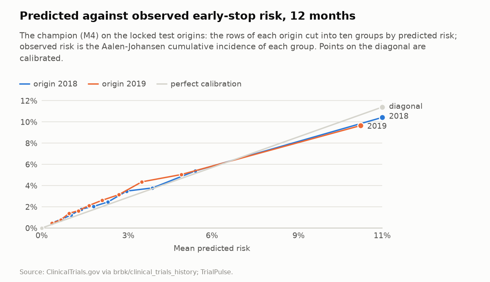
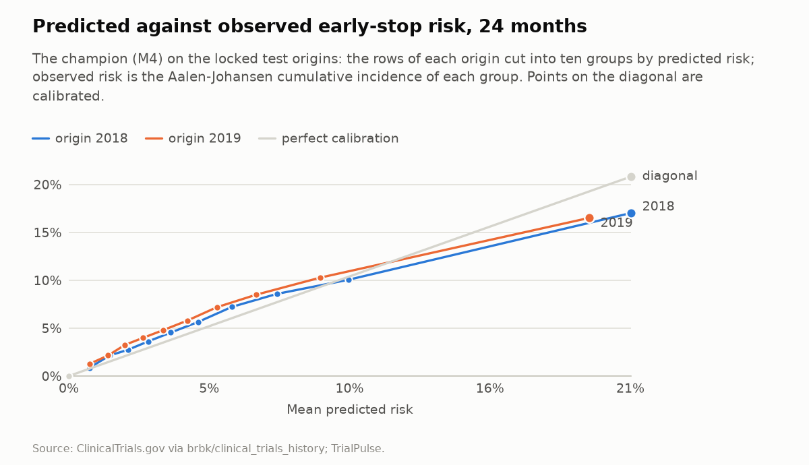

# Results on the locked origins

Research demo. Not medical advice. Not for patient decision-making.

This file is generated by `uv run python -m trialpulse.eval.results` from the result files of the locked run (CLAUDE.md Step 11). Do not edit it by hand. An elevated early-stop risk is an operational statement about a registry record; it says nothing about whether a treatment works.

- **Source:** ClinicalTrials.gov registry records, through the version-history dataset `brbk/clinical_trials_history` (license CC-BY-NC-4.0), revision v2026.09.26. Data as of 2026-09-25. TrialPulse normalizes the records and derives every number here.
- **Registration:** `docs/preregistration.md` registered on 2026-10-21, tag `prereg-v1` (tag object `b2af9c072fd1`) on commit `2ee8498a2fce`. Every result file below was made from that commit with a clean tree.
- **Origins:** 2018-01-01, 2019-01-01 (the locked test) and 2020-01-01 (the COVID stress test, reported separately).

## The registered predictions against the observed values

Primary claims in bold: the champion's AUC at 12 months on each test origin, and H2. Everything else is secondary. A prediction is falsified when its value falls outside its registered range, or when the condition of its hypothesis fails (section 1 of the registration).

| Prediction | What | Predicted | Acceptable range | Observed | Verdict |
| --- | --- | --- | --- | --- | --- |
| h1_delta_auc_12 | H1: M4 minus M1, AUC at landmark 0, 12 months | +0.007 | -0.02 to +0.02 | -0.0027 (-0.0166 to +0.0114) | **falsified**: the condition of H1 failed |
| h1_delta_auc_24 | H1: M4 minus M1, AUC at landmark 0, 24 months | +0.009 | above 0 to +0.03 | -0.0013 (-0.0098 to +0.0075) | **falsified**: outside the range and the condition of H1 failed |
| **h2_slope_12** | H2: slope of M3 minus M2 per landmark index, 12 months | +0.005 | above 0 to +0.012 | +0.0088 (+0.0060 to +0.0114) | within the range |
| h3_difference_12 | H3: operational minus scientific AUC, 12 months | +0.09 | +0.03 to +0.15 | +0.0229 (-0.0025 to +0.0494) | **falsified**: outside the range and the condition of H3 failed |
| h5_difference | H5: AUC at 2020 minus the mean of 2018 and 2019, 12 months | -0.025 | -0.08 to -0.005 | -0.0334 (-0.0464 to -0.0198) | within the range |
| h4_slope_12_2018 | H4: calibration slope, 12 months, 2018 | 0.89 | 0.8 to 1.2 | 0.8554 | **falsified**: the condition of H4 failed |
| h4_slope_24_2018 | H4: calibration slope, 24 months, 2018 | 0.84 | 0.8 to 1.2 | 0.7818 | **falsified**: outside the range and the condition of H4 failed |
| **auc_12_2018** | AUC, 12 months, 2018 | 0.725 | 0.7 to 0.75 | 0.7303 (0.7191 to 0.7414) | within the range |
| auc_24_2018 | AUC, 24 months, 2018 | 0.707 | 0.689 to 0.725 | 0.7099 (0.7016 to 0.7180) | within the range |
| brier_12_2018 | Brier score, 12 months, 2018 | 0.031 | 0.024 to 0.038 | 0.0300 (0.0289 to 0.0313) | within the range |
| brier_24_2018 | Brier score, 24 months, 2018 | 0.057 | 0.046 to 0.069 | 0.0567 (0.0551 to 0.0584) | within the range |
| lift_12_2018 | Lift at 10%, 12 months, 2018 | 3.1 | 2.6 to 3.7 | 3.2335 (3.0643 to 3.4466) | within the range |
| lift_24_2018 | Lift at 10%, 24 months, 2018 | 2.7 | 2.3 to 3.1 | 2.6871 (2.5532 to 2.8138) | within the range |
| h4_slope_12_2019 | H4: calibration slope, 12 months, 2019 | 0.89 | 0.8 to 1.2 | 0.8030 | **falsified**: the condition of H4 failed |
| h4_slope_24_2019 | H4: calibration slope, 24 months, 2019 | 0.84 | 0.8 to 1.2 | 0.7325 | **falsified**: outside the range and the condition of H4 failed |
| **auc_12_2019** | AUC, 12 months, 2019 | 0.725 | 0.7 to 0.75 | 0.7231 (0.7122 to 0.7340) | within the range |
| auc_24_2019 | AUC, 24 months, 2019 | 0.707 | 0.689 to 0.725 | 0.6956 (0.6872 to 0.7041) | within the range |
| brier_12_2019 | Brier score, 12 months, 2019 | 0.031 | 0.024 to 0.038 | 0.0297 (0.0285 to 0.0309) | within the range |
| brier_24_2019 | Brier score, 24 months, 2019 | 0.057 | 0.046 to 0.069 | 0.0583 (0.0566 to 0.0600) | within the range |
| lift_12_2019 | Lift at 10%, 12 months, 2019 | 3.1 | 2.6 to 3.7 | 3.0637 (2.8888 to 3.2537) | within the range |
| lift_24_2019 | Lift at 10%, 24 months, 2019 | 2.7 | 2.3 to 3.1 | 2.5588 (2.4448 to 2.6911) | within the range |

| Hypothesis | Condition met | How it was read |
| --- | --- | --- |
| H1 | **no** | absolute difference 0.0027 < 0.02 at 12 months, and -0.0013 > 0 at 24 months |
| H2 | yes | the interval of the slope starts at +0.0060 |
| H3 | **no** | the interval of the difference starts at -0.0025 |
| H4 | **no** | slopes 0.855, 0.803, 0.782, 0.732 against [0.8, 1.2] |
| H5 | yes | -0.0334 < 0 |

Falsified predictions: h1_delta_auc_12, h1_delta_auc_24, h3_difference_12, h4_slope_12_2018, h4_slope_24_2018, h4_slope_12_2019, h4_slope_24_2019.

Hypotheses whose condition failed: H1, H3, H4.

## Every model on the test origins

Pooled over the landmark indices each model scores (M1 scores landmark 0 only), with 95% cluster-bootstrap intervals over trials.

| Model | Origin | Rows | AUC, 12 months | AUC, 24 months | Brier, 12 months | Lift at 10%, 12 months | Slope, 12 months | Slope, 24 months |
| --- | --- | --- | --- | --- | --- | --- | --- | --- |
| M0 | 2018 | 86,556 | 0.543 (0.531 to 0.553) | 0.532 (0.524 to 0.541) | 0.0310 (0.0298 to 0.0323) | 1.56 (1.41 to 1.72) | 0.762 | 0.831 |
| M0 | 2019 | 90,985 | 0.541 (0.531 to 0.552) | 0.534 (0.526 to 0.542) | 0.0302 (0.0290 to 0.0315) | 1.53 (1.37 to 1.67) | 0.881 | 1.266 |
| M1 | 2018 | 18,536 | 0.688 (0.663 to 0.713) | 0.687 (0.670 to 0.705) | 0.0179 (0.0160 to 0.0196) | 2.32 (1.89 to 2.76) | 1.020 | 1.054 |
| M1 | 2019 | 18,973 | 0.684 (0.657 to 0.713) | 0.658 (0.640 to 0.676) | 0.0188 (0.0170 to 0.0206) | 2.35 (1.95 to 2.76) | 0.867 | 0.896 |
| M2 | 2018 | 86,556 | 0.663 (0.651 to 0.674) | 0.648 (0.639 to 0.657) | 0.0306 (0.0295 to 0.0319) | 2.15 (1.98 to 2.34) | 1.063 | 0.921 |
| M2 | 2019 | 90,985 | 0.653 (0.642 to 0.665) | 0.633 (0.624 to 0.642) | 0.0300 (0.0288 to 0.0312) | 2.01 (1.85 to 2.19) | 1.000 | 0.832 |
| M3 | 2018 | 86,556 | 0.702 (0.692 to 0.714) | 0.685 (0.677 to 0.694) | 0.0302 (0.0291 to 0.0315) | 2.90 (2.71 to 3.09) | 1.079 | 0.926 |
| M3 | 2019 | 90,985 | 0.693 (0.681 to 0.704) | 0.668 (0.659 to 0.677) | 0.0297 (0.0285 to 0.0309) | 2.76 (2.58 to 2.95) | 1.019 | 0.852 |
| M4 | 2018 | 86,556 | 0.730 (0.719 to 0.741) | 0.710 (0.702 to 0.718) | 0.0300 (0.0289 to 0.0313) | 3.23 (3.06 to 3.45) | 0.855 | 0.782 |
| M4 | 2019 | 90,985 | 0.723 (0.712 to 0.734) | 0.696 (0.687 to 0.704) | 0.0297 (0.0285 to 0.0309) | 3.06 (2.89 to 3.25) | 0.803 | 0.732 |
| M4-TEXT | 2018 | 86,556 | 0.731 (0.720 to 0.742) | 0.712 (0.704 to 0.720) | 0.0300 (0.0289 to 0.0313) | 3.27 (3.08 to 3.46) | 0.905 | 0.830 |
| M4-TEXT | 2019 | 90,985 | 0.723 (0.711 to 0.734) | 0.697 (0.689 to 0.706) | 0.0296 (0.0284 to 0.0308) | 3.10 (2.93 to 3.30) | 0.848 | 0.774 |

## The champion's AUC by landmark index

At 12 months:

| Landmark index | 2018 | 2019 |
| --- | --- | --- |
| 0 | 0.680 (0.653 to 0.707) | 0.687 (0.661 to 0.713) |
| 1 | 0.718 (0.691 to 0.741) | 0.698 (0.675 to 0.720) |
| 2 | 0.708 (0.684 to 0.732) | 0.708 (0.685 to 0.733) |
| 3 | 0.743 (0.719 to 0.764) | 0.711 (0.684 to 0.733) |
| 4 | 0.723 (0.699 to 0.746) | 0.734 (0.710 to 0.755) |
| 5 | 0.737 (0.714 to 0.763) | 0.738 (0.714 to 0.762) |
| 6 | 0.713 (0.682 to 0.744) | 0.732 (0.705 to 0.761) |

At 24 months:

| Landmark index | 2018 | 2019 |
| --- | --- | --- |
| 0 | 0.677 (0.660 to 0.696) | 0.664 (0.646 to 0.681) |
| 1 | 0.695 (0.677 to 0.713) | 0.670 (0.654 to 0.685) |
| 2 | 0.696 (0.680 to 0.713) | 0.690 (0.672 to 0.706) |
| 3 | 0.724 (0.706 to 0.740) | 0.693 (0.675 to 0.711) |
| 4 | 0.716 (0.698 to 0.734) | 0.722 (0.703 to 0.740) |
| 5 | 0.715 (0.696 to 0.735) | 0.720 (0.700 to 0.740) |
| 6 | 0.708 (0.685 to 0.731) | 0.725 (0.702 to 0.746) |

## Calibration of the champion

| Origin | Horizon (months) | Slope | Intercept |
| --- | --- | --- | --- |
| 2018 | 12 | 0.855 | +0.049 |
| 2018 | 24 | 0.782 | +0.021 |
| 2019 | 12 | 0.803 | +0.111 |
| 2019 | 24 | 0.732 | +0.141 |

## Sensitivity: one censoring curve for all rows

The champion's metrics with the censoring weights by sponsor class (the registered ones) beside the same metrics with one censoring curve for all rows (ADR 0017).

| Origin | Horizon (months) | AUC, by class | AUC, one curve | Brier, by class | Brier, one curve | Lift, by class | Lift, one curve | Slope, by class | Slope, one curve |
| --- | --- | --- | --- | --- | --- | --- | --- | --- | --- |
| 2018 | 12 | 0.730 (0.719 to 0.741) | 0.730 | 0.0300 (0.0289 to 0.0313) | 0.0301 | 3.23 (3.06 to 3.45) | 3.23 | 0.855 | 0.854 |
| 2018 | 24 | 0.710 (0.702 to 0.718) | 0.709 | 0.0567 (0.0551 to 0.0584) | 0.0568 | 2.69 (2.55 to 2.81) | 2.68 | 0.782 | 0.780 |
| 2019 | 12 | 0.723 (0.712 to 0.734) | 0.723 | 0.0297 (0.0285 to 0.0309) | 0.0297 | 3.06 (2.89 to 3.25) | 3.06 | 0.803 | 0.802 |
| 2019 | 24 | 0.696 (0.687 to 0.704) | 0.695 | 0.0583 (0.0566 to 0.0600) | 0.0584 | 2.56 (2.44 to 2.69) | 2.55 | 0.732 | 0.732 |

## Paired differences on the test origins

The mean over 2018 and 2019 of the difference in AUC, with paired cluster-bootstrap intervals (ADR 0025).

| Difference | 12 months, all indices | 12 months, landmark 0 | 24 months, all indices | 24 months, landmark 0 | Slope per landmark index, 12 months |
| --- | --- | --- | --- | --- | --- |
| M3 minus M2 | +0.0397 (+0.0346 to +0.0448) | +0.0093 (-0.0003 to +0.0197) | +0.0361 (+0.0320 to +0.0403) | +0.0119 (+0.0053 to +0.0184) | +0.0088 (+0.0060 to +0.0114) |
| M4-TEXT minus M4 | +0.0001 (-0.0042 to +0.0045) | -0.0068 (-0.0192 to +0.0065) | +0.0021 (-0.0017 to +0.0061) | +0.0039 (-0.0045 to +0.0122) |  |
| M4 minus M0 | +0.1848 (+0.1746 to +0.1951) | +0.1136 (+0.0928 to +0.1344) | +0.1695 (+0.1606 to +0.1787) | +0.1165 (+0.1025 to +0.1310) |  |
| M4 minus M1 |  | -0.0027 (-0.0166 to +0.0114) |  | -0.0013 (-0.0098 to +0.0075) |  |
| M4 minus M3 | +0.0290 (+0.0225 to +0.0351) | +0.0356 (+0.0197 to +0.0526) | +0.0261 (+0.0203 to +0.0311) | +0.0304 (+0.0205 to +0.0399) | -0.0019 (-0.0051 to +0.0013) |

## The trend over landmark indices (H2)

The slope of the least-squares line through the differences in AUC at landmark indices 0 to 6, and the mean difference at landmarks 4 to 6 minus the mean at 0 and 1, with paired cluster-bootstrap intervals. The slope at 12 months is H2; the rest is secondary.

| Difference | Horizon (months) | Slope per landmark index | Landmarks 4 to 6 minus 0 and 1 |
| --- | --- | --- | --- |
| M3 minus M2 | 12 | +0.0088 (+0.0060 to +0.0114) | +0.0438 (+0.0314 to +0.0555) |
| M3 minus M2 | 24 | +0.0087 (+0.0065 to +0.0108) | +0.0433 (+0.0336 to +0.0524) |
| M4 minus M3 | 12 | -0.0019 (-0.0051 to +0.0013) | -0.0051 (-0.0193 to +0.0100) |
| M4 minus M3 | 24 | -0.0011 (-0.0036 to +0.0011) | -0.0030 (-0.0148 to +0.0075) |

## Cause-specific results: operational and scientific stops (H3)

The champion's all-cause score held against operational and against scientific early stops (ADR 0028), with the censoring weights of all evaluation rows; paired cluster-bootstrap intervals at each origin and over both. Errors between the operational and scientific labels push the difference toward zero as long as they do not depend on the risk score; errors into or out of the label other move a score toward the AUC of the stops labeled other (section H3 of the registration).

| Origin | Horizon (months) | Operational stops | AUC, operational | Scientific stops | AUC, scientific | Difference |
| --- | --- | --- | --- | --- | --- | --- |
| 2018 | 12 | 1,919 | 0.731 (0.718 to 0.744) | 236 | 0.722 (0.686 to 0.757) | +0.008 (-0.030 to +0.044) |
| 2019 | 12 | 2,052 | 0.728 (0.715 to 0.740) | 259 | 0.690 (0.655 to 0.725) | +0.037 (+0.002 to +0.073) |
| 2018 and 2019 (mean) | 12 |  | 0.729 (0.720 to 0.739) |  | 0.706 (0.681 to 0.730) | +0.023 (-0.002 to +0.049) |
| 2018 | 24 | 3,763 | 0.711 (0.701 to 0.720) | 480 | 0.693 (0.667 to 0.719) | +0.018 (-0.010 to +0.044) |
| 2019 | 24 | 4,245 | 0.698 (0.688 to 0.708) | 494 | 0.675 (0.649 to 0.702) | +0.022 (-0.005 to +0.052) |
| 2018 and 2019 (mean) | 24 |  | 0.704 (0.697 to 0.713) |  | 0.684 (0.664 to 0.704) | +0.020 (-0.001 to +0.042) |

## Sensitivity: UNKNOWN as an early stop

The champion, trained as in the main run, scores a cohort in which a trial lapsed at the data cutoff stops early at its lapse date (Section 6, ADRs 0014 and 0029).

| Origin | Horizon (months) | Rows, main | Rows, variant | AUC, main | AUC, variant | Brier, main | Brier, variant | Lift, main | Lift, variant | Slope, main | Slope, variant |
| --- | --- | --- | --- | --- | --- | --- | --- | --- | --- | --- | --- |
| 2018 | 12 | 86,556 | 101,737 | 0.730 (0.719 to 0.741) | 0.667 (0.659 to 0.674) | 0.0300 (0.0289 to 0.0313) | 0.0711 (0.0692 to 0.0729) | 3.23 (3.06 to 3.45) | 2.30 (2.21 to 2.41) | 0.855 | 0.613 |
| 2018 | 24 | 86,556 | 101,737 | 0.710 (0.702 to 0.718) | 0.568 (0.561 to 0.574) | 0.0567 (0.0551 to 0.0584) | 0.1455 (0.1429 to 0.1481) | 2.69 (2.55 to 2.81) | 1.56 (1.50 to 1.62) | 0.782 | 0.268 |
| 2019 | 12 | 90,985 | 108,205 | 0.723 (0.712 to 0.734) | 0.655 (0.648 to 0.662) | 0.0297 (0.0285 to 0.0309) | 0.0723 (0.0706 to 0.0740) | 3.06 (2.89 to 3.25) | 2.18 (2.08 to 2.27) | 0.803 | 0.556 |
| 2019 | 24 | 90,985 | 108,205 | 0.696 (0.687 to 0.704) | 0.555 (0.550 to 0.562) | 0.0583 (0.0566 to 0.0600) | 0.1519 (0.1496 to 0.1547) | 2.56 (2.44 to 2.69) | 1.50 (1.45 to 1.56) | 0.732 | 0.218 |

## The COVID stress test (origin 2020), reported separately

The champion at 2020-01-01: AUC at 12 months 0.693 (0.683 to 0.704), at 24 months 0.680 (0.672 to 0.688); Brier score at 12 months 0.0348 (0.0335 to 0.0362); calibration slope 0.664 and 0.644. H5: the AUC at 12 months minus the mean of 2018 and 2019 is -0.0334 (-0.0464 to -0.0198).

## Runs

| File | Run | Run id |
| --- | --- | --- |
| compare/test/m3__m2.json | compare-m3-vs-m2-test | 92d68b73 |
| compare/test/m4-text__m4.json | compare-m4-text-vs-m4-test | c9f9468b |
| compare/test/m4__m0.json | compare-m4-vs-m0-test | 3d612416 |
| compare/test/m4__m1.json | compare-m4-vs-m1-test | 39a59cb1 |
| compare/test/m4__m3.json | compare-m4-vs-m3-test | 1c193062 |
| hypotheses/h3-test.json | h3-test | d6dd99fc |
| hypotheses/h5.json | h5 | f3b6e5d5 |
| walkforward/m0_2018.json | m0-2018 | e66abb1d |
| walkforward/m0_2019.json | m0-2019 | ee2b8a93 |
| walkforward/m0_2020.json | m0-2020 | 516dbe80 |
| walkforward/m1_2018.json | m1-2018 | 6a0ff284 |
| walkforward/m1_2019.json | m1-2019 | 3a768c33 |
| walkforward/m1_2020.json | m1-2020 | 30220c04 |
| walkforward/m2_2018.json | m2-2018 | 9d5371b9 |
| walkforward/m2_2019.json | m2-2019 | 62f55af6 |
| walkforward/m2_2020.json | m2-2020 | 03a10702 |
| walkforward/m3_2018.json | m3-2018 | 73cc08be |
| walkforward/m3_2019.json | m3-2019 | 213bec32 |
| walkforward/m3_2020.json | m3-2020 | 4228e348 |
| walkforward/m4-text_2018.json | m4-text-2018 | 39f01117 |
| walkforward/m4-text_2019.json | m4-text-2019 | 93c5ec11 |
| walkforward/m4-text_2020.json | m4-text-2020 | eb318e31 |
| walkforward/m4_2018.json | m4-2018 | 835ae4a1 |
| walkforward/m4_2019.json | m4-2019 | 074ec61a |
| walkforward/m4_2020.json | m4-2020 | 947d1684 |
| walkforward/unknown-as-stop/m4_2018.json | m4-2018-unknown-as-stop | 8b0b8509 |
| walkforward/unknown-as-stop/m4_2019.json | m4-2019-unknown-as-stop | 00dc0f20 |
